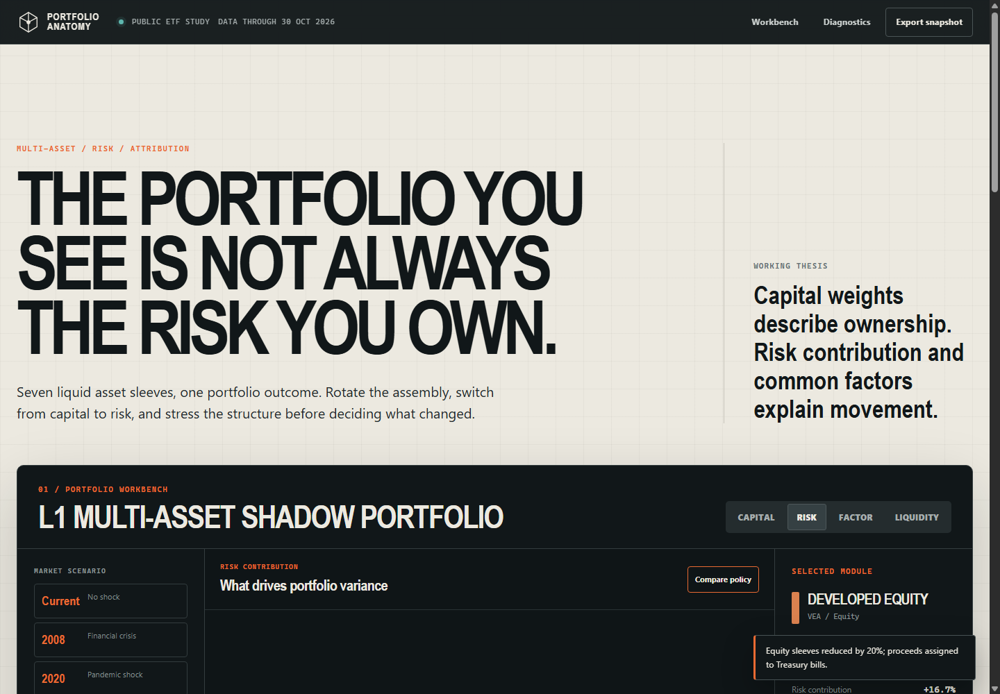

# Portfolio Anatomy

**An interactive multi-asset portfolio diagnostic.**

[](https://aayloo.github.io/portfolio-anatomy/)

Portfolio Anatomy is a public-data research exhibit built around one question:
what does a portfolio actually own when capital, risk and factor exposure are
viewed separately?

## What it shows

- current and policy asset weights;
- variance contribution by sleeve;
- annual return attribution by sleeve;
- factor-sensitivity and liquidity views;
- 2008, 2020 and 2022 historical stress mappings;
- reversible de-risking, exploded-view, asset-isolation and scenario-snapshot controls.

The central Three.js model is a structural metaphor. Module size, distance,
connector intensity and stress displacement change by view. The authoritative
numbers remain in the HTML diagnostics and labels.

## Run locally

No build step is required:

```bash
python -m http.server 8000
```

Open <http://localhost:8000>.

For a headless responsive and interaction check:

```bash
node scripts/qa.mjs
```

## Data

The study uses the existing public-ETF L1 shadow-portfolio outputs. Baseline
metrics and variance contributions are frozen at 30 October 2026. Historical
scenario impacts are illustrative mappings for structural comparison, not
forecasts or investment advice.

## Technology

- dependency-free HTML, CSS and JavaScript;
- local Three.js renderer;
- SVG diagnostic charts generated from one shared portfolio state;
- keyboard-accessible controls and a no-WebGL fallback;
- responsive desktop and mobile layouts.

## License

MIT. See `LICENSE` and `THIRD_PARTY_NOTICES.md`.
